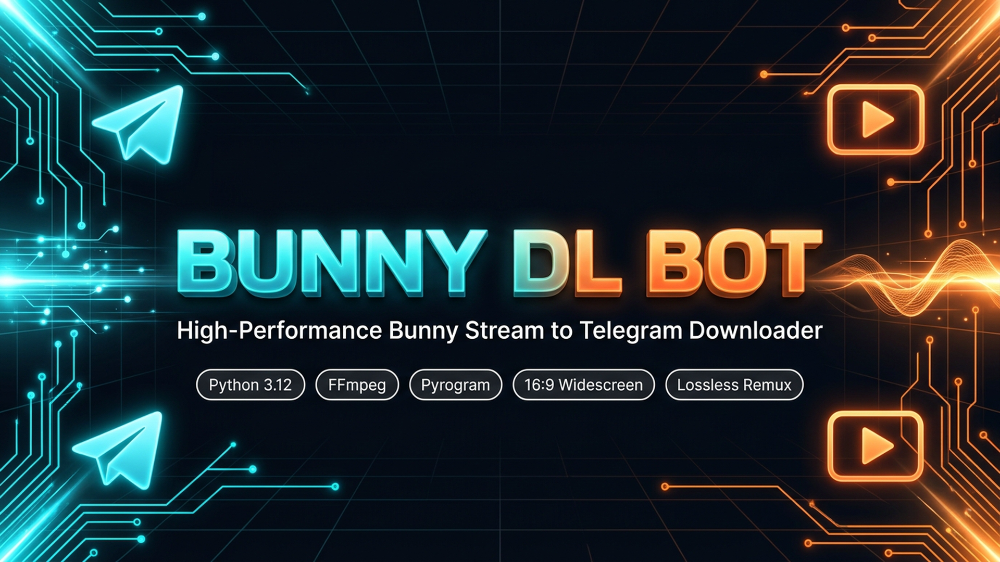
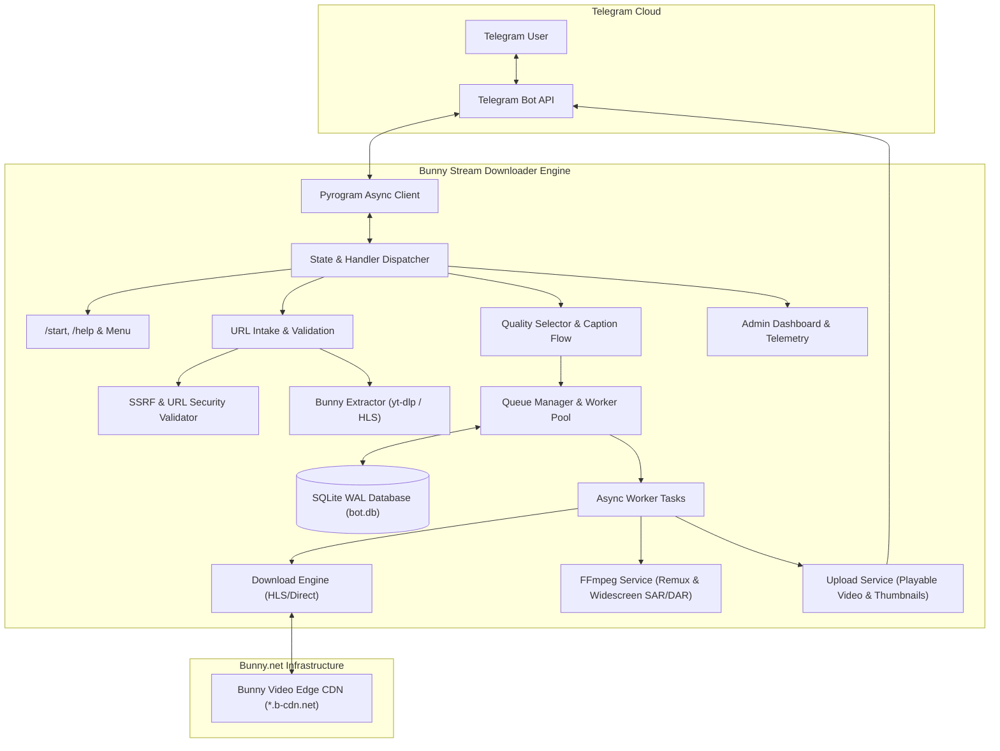
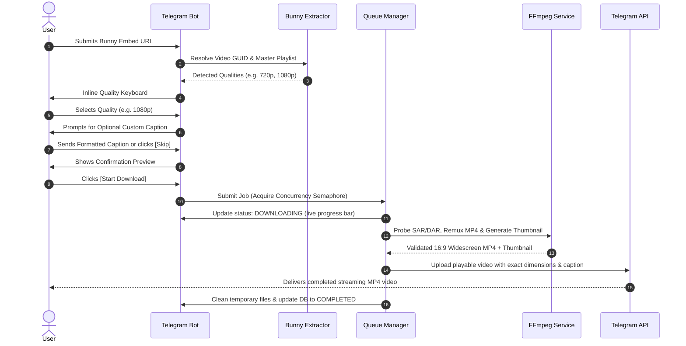

<p align="center">
  <a href="https://github.com/NimeshPiyathissa/bunny-telegram-bot">
    
  </a>
</p>

<p align="center">
  <strong>Production-grade, asynchronous Telegram bot engineered to ingest authorized Bunny Stream embeds, extract multi-bitrate HLS streams, remux losslessly with FFmpeg, and deliver 16:9 widescreen MP4 videos directly to Telegram chats.</strong>
</p>

<p align="center">
  <a href="https://github.com/NimeshPiyathissa/bunny-telegram-bot/releases/tag/v1.0.0"></a>
  <a href="https://github.com/NimeshPiyathissa/bunny-telegram-bot/actions/workflows/ci.yml"></a>
  <a href="https://www.python.org/downloads/"></a>
  <a href="https://ffmpeg.org/"></a>
  <a href="https://docs.pyrogram.org/"></a>
  <a href="https://www.sqlite.org/wal.html"></a>
  <a href="https://ubuntu.com/"></a>
  <a href="https://docs.docker.com/"></a>
  <a href="LICENSE"></a>
</p>

<p align="center">
  <a href="#quick-start-60-seconds">⚡ Quick Start</a> •
  <a href="#key-features">🌟 Features</a> •
  <a href="#system-architecture">🏗️ Architecture</a> •
  <a href="#ubuntu-2404-lts-production-deployment-systemd">🐧 Deployment</a> •
  <a href="#devops--maintenance-tooling">🛠️ DevOps</a> •
  <a href="#environment-configuration-reference">⚙️ Configuration</a> •
  <a href="#command-reference">🎮 Commands</a>
</p>

---

## ⚡ Quick Start (60 Seconds)

Deploy to any Ubuntu 22.04 / 24.04 LTS server in four commands:

```bash
# 1. Clone repository
git clone https://github.com/NimeshPiyathissa/bunny-telegram-bot.git /opt/bunny-bot && cd /opt/bunny-bot

# 2. Run automated OS-level provisioner (installs FFmpeg 7+, Python 3.12, .venv)
sudo bash scripts/setup_ubuntu.sh

# 3. Configure credentials
cp .env.example .env && nano .env

# 4. Install & launch hardened systemd daemon
sudo bash scripts/install_service.sh
```

---

## 📑 Table of Contents

- [Quick Start (60 Seconds)](#quick-start-60-seconds)
- [Key Features](#key-features)
- [System Architecture](#system-architecture)
- [Video Processing Pipeline](#video-processing-pipeline)
- [User Experience & Visual Interface](#user-experience--visual-interface)
- [Prerequisites](#prerequisites)
- [Ubuntu 24.04 LTS Production Deployment (systemd)](#ubuntu-2404-lts-production-deployment-systemd)
- [Docker & Docker Compose Deployment](#docker--docker-compose-deployment)
- [Windows 10/11 Development Setup](#windows-1011-development-setup)
- [DevOps & Maintenance Tooling](#devops--maintenance-tooling)
  - [1. Automated Atomic Backups](#1-automated-atomic-backups)
  - [2. Safe Database Restore](#2-safe-database-restore)
  - [3. Zero-Downtime Updates](#3-zero-downtime-application-update)
  - [4. System Health Diagnostics](#4-system-health-diagnostics)
- [Environment Configuration Reference](#environment-configuration-reference)
- [Storage Lifecycle & Automatic Cleanup Architecture](#storage-lifecycle--automatic-cleanup-architecture)
- [Command Reference](#command-reference)
- [Security Defenses & Access Control](#security-defenses--access-control)
- [Automated Testing & QA](#automated-testing--qa)
- [Compliance & Responsible Use](#compliance--responsible-use)
- [Contributing & License](#contributing--license)

---

## 🌟 Key Features

| Capability | Technical Implementation | Benefit |
| :--- | :--- | :--- |
| **🎥 Intelligent Bunny Stream Ingestion** | yt-dlp & HLS Master Parser with regex URL intake | Resolves `iframe.mediadelivery.net` embeds, queries dynamic manifests, and renders only available resolutions (360p to 4K). |
| **📐 16:9 Widescreen Optimization** | FFprobe SAR/DAR inspection & Pyrogram stream metadata | Forces native display geometry (`width`, `height`, `duration`), preventing black letterboxing, pillarboxing, and distorted playback. |
| **🖼️ Aspect-Ratio Preserving Thumbnails** | Frame capture at 10% stream duration with aspect scaling | Generates crisp video cover previews scaled exactly to the source video dimensions. |
| **✍️ Interactive Rich Caption Engine** | Multi-step Telegram conversation state machine | Preserves rich formatting (bold, italic, code, underline, hyperlinks, Sinhala/Unicode) before queueing. |
| **⚡ Concurrency & SQLite WAL Queue** | Asyncio Worker Pool + SQLite `WAL` mode (`busy_timeout=10000`) | Non-blocking database transactions, per-user fair limits, worker supervision, and startup stale-job reconciliation. |
| **📊 Real-Time Throttled Dashboard** | 3-second update throttle with Unicode progress bars | Displays live progress (`████████░░░░ 50%`), speed in MB/s, transferred bytes, and ETA without hitting Telegram `FloodWait`. |
| **🛡️ Enterprise Zero-Trust Security** | DNS resolution check + RFC 1918 / Cloud Metadata SSRF filters | Blocks private subnets, localhost, and AWS/GCP metadata endpoints. FFmpeg subprocess arguments passed as immutable arrays. |
| **🧹 Safe Non-Destructive Storage** | Guaranteed delivery confirmation before local deletion | Local temporary files are pruned **only after** Telegram confirms message receipt. Delivered messages are never deleted. |

---

### Detailed Feature Breakdown

#### 🎥 Intelligent Bunny Stream Ingestion
- **Embed URL Parsing**: Resolves standard Bunny Stream web player embeds (`https://iframe.mediadelivery.net/embed/{library_id}/{video_guid}`) into authorized master HLS playlists and CDN endpoints.
- **Dynamic Quality Probing**: Probes actual resolutions available on the source manifest (360p, 480p, 720p, 1080p, 1440p, 4K) and renders an interactive Telegram keyboard containing only valid tiers.
- **Direct & Fallback Stream Handling**: Seamlessly downloads segmented HLS streams or direct MP4 assets, resolving separate audio and video tracks without quality loss.

#### 📐 16:9 Native Aspect Ratio & Widescreen Optimization
- **Geometry & SAR/DAR Inspection**: Uses FFprobe to inspect raw dimensions, Sample Aspect Ratio (SAR), Display Aspect Ratio (DAR), and rotation flags.
- **Distortion-Free Telegram Playback**: Supplies exact display dimensions (`width`, `height`) and `duration` metadata to Telegram's player, preventing black bars, letterboxing distortion, and stretched frames.
- **Aspect-Ratio Preserving Thumbnails**: Extracts crisp video cover previews from 10% into the stream, scaled precisely to match the source aspect ratio.

#### ✍️ Interactive Custom Caption Engine
- **Rich-Text Entity Support**: Allows users to input customized video descriptions prior to download, preserving Telegram formatting (bold, italic, code, underline, strikethrough, and hyperlinked text).
- **Interactive Multi-Step State Flow**: Guided inline UX: Resolution Selection ➔ Custom Caption Prompt (with Skip option) ➔ Preview Confirmation ➔ Queue Submission.

#### ⚡ Concurrency Control & Queue Management
- **Asyncio Worker Pool**: Dedicated background worker pool throttled by a global concurrency semaphore (`MAX_CONCURRENT_DOWNLOADS`).
- **Fair-Use Per-User Throttling**: Limits active concurrent downloads per user (`MAX_DOWNLOADS_PER_USER`) with real-time position notices.
- **Persistent SQLite Job Store**: Records every job lifecycle state (`QUEUED`, `EXTRACTING`, `DOWNLOADING`, `MERGING`, `UPLOADING`, `COMPLETED`, `FAILED`, `CANCELLED`) in an asynchronous SQLite database via SQLAlchemy, with automated WAL (Write-Ahead Logging) journal mode, `busy_timeout=10000`, and concurrent transaction support.
- **Stale Job Reconciliation**: Automatically cleans up and recovers orphaned in-flight tasks upon bot restarts.

#### 📊 Real-Time Throttled Progress Dashboard
- **Live Transfer Metrics**: Dynamic Unicode progress bars (`████████░░░░░░░░ 50%`) with downloaded bytes, total file size, real-time speed in MB/s, and accurate ETA countdown.
- **Telegram Flood Protection**: Throttles status message edits (3-second cooldown) to eliminate Telegram `FloodWait` API penalties.

#### 🛡️ Enterprise-Grade Security
- **Strict SSRF Mitigation**: Pre-resolves domain names and blocks loopback, link-local, private IP spaces (`10.0.0.0/8`, `172.16.0.0/12`, `192.168.0.0/16`, `127.0.0.0/8`, `169.254.169.254`, `::1`, `fc00::/7`), and cloud metadata APIs.
- **Subprocess Argument Sanitization**: Invokes FFmpeg via safe argument lists (`asyncio.create_subprocess_exec`) with strict control-character stripping—never through shell string interpolation.
- **Token & Key Redaction**: Custom logging filter scrubs bot tokens, API hashes, session strings, and signed URLs from disk logs and terminal outputs.

---

## 🏗️ System Architecture



---

## 🔄 Video Processing Pipeline



---

## 📱 User Experience & Visual Interface

### 1. Interactive Main Menu
```text
/start
   │
   ▼
🎬 BUNNY STREAM DOWNLOADER
Your Premium Video Download Assistant
━━━━━━━━━━━━━━━━━━━━━━━━━━━━━━━━
📥 Download authorized Bunny videos
🎞️ Lossless MP4 processing & FFmpeg remux
📐 True 16:9 widescreen video delivery
⚡ Non-blocking asynchronous worker queue
☁️ Direct Telegram streaming playback
━━━━━━━━━━━━━━━━━━━━━━━━━━━━━━━━
📊 System: Online
🟢 Downloader: Ready

[ 📥 Download Video ]
[ 📂 My Downloads ]   [ 📊 Status ]
[ ⚙️ Settings ]       [ ❓ Help ]
```

### 2. URL Intake & Quality Selection
```text
User submits embed link:
https://iframe.mediadelivery.net/embed/12345/a1b2c3d4-e5f6-7a8b-9c0d-1e2f3a4b5c6d
   │
   ▼
🎬 VIDEO DETECTED
📺 Title: Biology Lecture - Monosaccharides
⏱️ Duration: 00:27:04

Select desired download resolution:
[ 360p (140 MB) ]    [ 480p (230 MB) ]
[ 720p (580 MB) ]    [ 1080p (1.1 GB) ]
[ ⭐ Best Available ]
[ ❌ Cancel ]
```

### 3. Custom Rich Caption Prompt
```text
User selects [ 1080p ]:
   │
   ▼
✍️ CUSTOM CAPTION (OPTIONAL)
Selected: 1080p

Send your custom video caption now.
Rich text formatting (bold, italic, code, links) will be preserved.

[ ⏭️ Skip Caption ]  [ ⬅️ Change Quality ]
[ ❌ Cancel Download ]
```

### 4. Live Transfer Dashboard
```text
Live Throttled Progress Dashboard:
   │
   ▼
⬇️ DOWNLOADING VIDEO
🎬 Video: Biology Lecture - Monosaccharides
📺 Quality: 1080p

████████████░░░░ 68%

📦 Downloaded: 748 MB
📊 Total: 1.10 GB
⚡ Speed: 14.8 MB/s
⏳ ETA: 00:24

Status: Downloading stream segments...
```

---

## 📋 Prerequisites

| Component | Minimum Version | Recommended Version | Purpose |
| :--- | :--- | :--- | :--- |
| **Operating System** | Ubuntu 22.04 LTS / Windows 10 | **Ubuntu 24.04 LTS** / Windows 11 | Host operating system |
| **Python** | 3.11 | **3.12+** | Async runtime environment |
| **FFmpeg** | 5.0 | **7.0+** (with `libx264`, `aac`, `ffprobe`) | Lossless stream remuxing & metadata probe |
| **SQLite** | 3.35+ | **3.40+** (with WAL mode support) | Concurrent transactional job storage |
| **RAM** | 1 GB | **2 GB+** | Segment buffering and remux operations |
| **Disk** | 5 GB SSD free space | **25 GB+ NVMe SSD** | Temporary video processing storage |
| **Telegram API** | Valid Credentials | Bot Token ([@BotFather](https://t.me/BotFather)) + API ID/Hash ([my.telegram.org](https://my.telegram.org)) | Telegram client communication |

---

## 🐧 Ubuntu 24.04 LTS Production Deployment (systemd)

Ubuntu 24.04 LTS (Noble Numbat) is the primary targeted server platform. The automated setup adheres strictly to modern Linux standards (including PEP 668 managed virtual environments).

### 1. Clone Repository & Run Automated Installer
```bash
# Navigate to deployment directory
cd /opt

# Clone repository
sudo git clone https://github.com/NimeshPiyathissa/bunny-telegram-bot.git bunny-bot
cd bunny-bot

# Run the automated installer (installs system packages, creates .venv, configures runtime dirs)
sudo bash scripts/setup_ubuntu.sh
```

### 2. Configure Credentials
```bash
# Edit environment file with your credentials
sudo nano .env
```
Populate your `BOT_TOKEN`, `API_ID`, `API_HASH`, and `OWNER_ID`.

### 3. Install & Start systemd Daemon
```bash
# Install systemd service unit with auto-restart on boot
sudo bash scripts/install_service.sh

# Start the service
sudo systemctl start bunny-bot

# Verify service status
sudo systemctl status bunny-bot
```

### 4. Monitor Live System Logs
```bash
sudo journalctl -u bunny-bot -f
```

---

## 🐳 Docker & Docker Compose Deployment

The project provides a hardened, non-root multi-stage Docker image and compose definition.

### 1. Configure Environment
```bash
cp .env.example .env
nano .env
```

### 2. Build and Launch Containers
```bash
docker compose up -d --build
```

### 3. Service Management Commands
```bash
# Check container status and health
docker compose ps

# View live application logs
docker compose logs -f

# Restart container
docker compose restart

# Stop container
docker compose down
```

---

## 🪟 Windows 10/11 Development Setup

For local testing and development on Windows workstations:

### 1. Install Python & FFmpeg
1. Download **Python 3.12+** from [python.org](https://www.python.org/downloads/). Enable **"Add python.exe to PATH"**.
2. Install **FFmpeg** via Windows Package Manager:
   ```powershell
   winget install Gyan.FFmpeg
   ```

### 2. Run Automated Setup Script
```powershell
# Open PowerShell in project directory and execute:
Set-ExecutionPolicy -Scope Process -ExecutionPolicy Bypass
.\scripts\setup_windows.ps1
```

### 3. Configure Credentials & Launch
```powershell
notepad .env
.\.venv\Scripts\Activate.ps1
python bot.py
```

---

## 🛠️ DevOps & Maintenance Tooling

The [`scripts/`](scripts/) directory contains hardened operational tools designed for production maintenance.

### 1. Automated Atomic Backups
Performs an online, non-blocking snapshot of SQLite (`data/bot.db`), capturing active WAL (`-wal`) and shared memory (`-shm`) journals, and archives `.env` with restricted 600 permissions. Automatically prunes archives older than 30 days.
```bash
bash scripts/backup.sh
```

### 2. Safe Database Restore
Verifies backup archive integrity with `PRAGMA integrity_check`, safely stops the service to prevent database lockups, creates a safety snapshot of the active database, cleans old WAL files, and performs an atomic restore.
```bash
bash scripts/restore.sh backups/bot_db_20261108_120000.db
```

### 3. Zero-Downtime Application Update
Safely pulls updates, updates dependencies, verifies database schema, and **executes the automated test suite** before restarting the systemd service. If tests fail, update halts without restarting the service.
```bash
bash scripts/update.sh
```

### 4. System Health Diagnostics
Inspects process status, database responsiveness, partition disk space thresholds, FFmpeg availability, and recent error log frequency.
```bash
bash scripts/healthcheck.sh
```

---

## ⚙️ Environment Configuration Reference

| Variable | Type | Default | Description |
| :--- | :--- | :--- | :--- |
| `BOT_TOKEN` | String | *Required* | Telegram Bot API token obtained from [@BotFather](https://t.me/BotFather) |
| `API_ID` | Integer | *Required* | Telegram API ID from [my.telegram.org](https://my.telegram.org) |
| `API_HASH` | String | *Required* | Telegram API Hash from [my.telegram.org](https://my.telegram.org) |
| `OWNER_ID` | Integer | *Required* | Numeric Telegram ID of primary bot administrator |
| `ADMIN_IDS` | String | `""` | Comma-separated list of secondary admin IDs (e.g. `111,222`) |
| `DATABASE_URL` | String | `sqlite+aiosqlite:///./data/bot.db` | Async SQLAlchemy database connection URL |
| `MAX_CONCURRENT_DOWNLOADS` | Integer | `2` | Maximum global worker tasks downloading simultaneously |
| `MAX_DOWNLOADS_PER_USER` | Integer | `1` | Maximum concurrent active download jobs allowed per user |
| `MAX_FILE_SIZE_MB` | Integer | `1900` | File size ceiling in MB (Telegram default maximum: 2000 MB) |
| `DOWNLOAD_TIMEOUT_SECONDS` | Integer | `3600` | Maximum allowed runtime per media download before timing out |
| `UPLOAD_TIMEOUT_SECONDS` | Integer | `1800` | Maximum allowed runtime for Telegram video upload |
| `AUTO_CLEANUP` | Boolean | `true` | Enables scheduled background garbage collection of orphan temporary files |
| `CLEANUP_AFTER_UPLOAD` | Boolean | `true` | Automatically deletes local MP4, thumbnails, segments, and temp workspace after confirmed delivery |
| `FAILED_JOB_RETENTION_HOURS` | Integer | `24` | Hours to retain failed/uncompleted download workspaces for recovery/inspection |
| `TEMP_FILE_RETENTION_HOURS` | Integer | `6` | Hours to retain abandoned temporary files before automatic garbage collection |
| `MIN_FREE_DISK_GB` | Integer | `3` | Minimum free disk space in GB required before rejecting new jobs or triggering emergency cleanup |
| `DOWNLOAD_DIRECTORY` | String | `./downloads` | Directory where active video files are downloaded |
| `TEMP_DIRECTORY` | String | `./temp` | Directory where per-job isolated workspaces are created |
| `BACKUP_DIRECTORY` | String | `./backups` | Directory where database and config backups are archived |
| `LOG_LEVEL` | String | `INFO` | Application log verbosity (`DEBUG`, `INFO`, `WARNING`, `ERROR`) |
| `ENABLE_USER_SESSION` | Boolean | `false` | Enable Pyrogram user session for uploading files up to 4 GB |
| `SESSION_STRING` | String | `""` | String session token when `ENABLE_USER_SESSION` is true |

---

## 🧹 Storage Lifecycle & Automatic Cleanup Architecture

The bot employs a safe, non-destructive storage management architecture designed for VPS and local environments:

1. **Isolated Per-Job Workspaces**:
   Every download job executes in an isolated workspace (`temp/job_{job_id}/`). Intermediate HLS segments, converted video/audio streams, and preview thumbnails are stored exclusively inside this folder.
2. **Delivery Confirmation Before Deletion**:
   Local media files are deleted **only after Telegram's API returns a valid Message object** confirming that the video was received by Telegram's cloud servers. The Telegram message ID and file ID are persisted to `data/bot.db`.
3. **Strict Message Preservation**:
   The bot **never** calls `delete_messages` or deletes delivered Telegram messages during local cleanup.
4. **Protected System & User Files**:
   Cleanup operations are strictly bounded to `temp/` and `downloads/`. The application database (`data/bot.db`), database journals (`-wal`, `-shm`), Telegram sessions (`*.session*`), `.env`, and source files are immutably excluded from deletion.
5. **Cross-Platform Lock Handling**:
   On Windows workstations, file locks (`PermissionError` / `WinError 32`) are handled via automated garbage collection (`gc.collect()`), read-only flag removal, and exponential retry backoff.
6. **Bounded Upload Retries & Uncertain Delivery**:
   Upload failures trigger up to 3 retry attempts with exponential backoff. If a connection times out while delivery status is uncertain, the bot avoids blind re-sends to prevent duplicate Telegram messages and flags the job in a `RECOVERY` state.
7. **Disk Space Threshold & Emergency Cleaning**:
   Before initiating downloads, free disk capacity is validated against `MIN_FREE_DISK_GB`. If storage is low, emergency garbage collection is dispatched to prune old abandoned workspaces.

---

## 🎮 Command Reference

### User Commands
- `/start` — Initialize bot session, show welcome panel, and open interactive keyboard menu.
- `/download [url]` — Enter download state or directly process an authorized Bunny embed URL.
- `/status` — View in-flight download jobs and live progress metrics for the current user.
- `/cancel` — Gracefully cancel the active job belonging to the caller.
- `/help` — Display comprehensive usage guide, instructions, and supported link formats.

### Admin Commands (Restricted to `OWNER_ID` & `ADMIN_IDS`)
- `/admin` — Open interactive admin control dashboard with system telemetry.
- `/stats` — Query CPU load, memory utilization, disk space, and total download count.
- `/users` — Display user registration statistics and active accounts.
- `/jobs` — Inspect real-time status of all active and queued background jobs.
- `/broadcast <msg>` — *(Owner Only)* Dispatch broadcast notification to all registered users.
- `/ban <user_id>` — Ban a user from submitting downloads.
- `/unban <user_id>` — Revoke ban status for a user.
- `/restart` — *(Owner Only)* Initiate graceful shutdown for systemd/Docker auto-restart.

---

## 🔒 Security Defenses & Access Control

1. **Server-Side Request Forgery (SSRF) Defense**:
   - Every input URL is validated against strict regex patterns.
   - Hostnames are resolved to IP addresses via DNS prior to connection.
   - Requests directed at loopback (`127.0.0.0/8`, `::1`), private subnets (`10.0.0.0/8`, `172.16.0.0/12`, `192.168.0.0/16`), link-local addresses (`169.254.0.0/16`), or cloud instance metadata servers are rejected immediately.
2. **Subprocess Injection Immunity**:
   - FFmpeg and FFprobe calls are dispatched through `asyncio.create_subprocess_exec` passing arguments as immutable arrays.
   - Non-printable control characters, null bytes, and path traversal tokens are sanitized.
3. **Secret Redaction**:
   - `SecretFilter` logging middleware automatically scrubs Telegram bot tokens, API hashes, session strings, and signed token queries before records reach logs or console streams.
4. **Filesystem Isolation**:
   - The systemd unit enables `PrivateTmp=true`, `ProtectSystem=full`, `ProtectHome=read-only`, and drops unnecessary Linux capabilities (`NoNewPrivileges=true`).

---

## 🧪 Automated Testing & QA

The project maintains an asynchronous test suite built on `pytest` and `pytest-asyncio`.

```bash
# Activate virtual environment
source .venv/bin/activate   # or .\.venv\Scripts\Activate.ps1 on Windows

# Execute full test suite
pytest -v --tb=short
```

### Test Suite Coverage

| Test Module | Coverage Scope | Status |
| :--- | :--- | :---: |
| **`tests/test_aspect_ratio.py`** | 16:9 widescreen detection, Display Aspect Ratio (DAR), Sample Aspect Ratio (SAR), rotation correction, and thumbnail aspect preservation | **10 Passed** |
| **`tests/test_caption.py`** | Interactive caption state flow, rich text entity preservation (bold, italic, code, underline), skip options, and edit cycles | **8 Passed** |
| **`tests/test_urls.py`** | Bunny embed URL pattern matching, GUID extraction, parameter sanitization, and invalid domain rejection | **5 Passed** |
| **`tests/test_extractor.py`** | yt-dlp format detection, HLS manifest parsing, and 403 Forbidden handling | **4 Passed** |
| **`tests/test_download.py`** | FFmpeg lossless remuxing, MP4 `ftyp` magic bytes validation, and document fallback | **12 Passed** |
| **`tests/test_queue.py`** | Worker pool concurrency limits, per-user limits, cancellation events, and stale job startup reconciliation | **12 Passed** |
| **`tests/test_security.py`** | SSRF blocks against private IP spaces, cloud metadata addresses, and command injection attacks | **5 Passed** |
| **`tests/test_handlers.py`** | HTML parser compatibility with Telegram message length constraints and menu routing | **8 Passed** |
| **`tests/test_vps_release.py`** | Delivery lifecycle contract, safe deletion, SQLite WAL mode & concurrency, and deployment script validation | **12 Passed** |

---

## ⚖️ Compliance & Responsible Use

- **Authorized Media Ingestion**: This software is intended exclusively for content creators, platform operators, and developers downloading media assets they own or have explicit legal authorization to access.
- **Access Control Integrity**: This application **does not** crack tokens, bypass DRM encryption, or circumvent access control measures. If a Bunny Stream asset returns `403 Forbidden` due to token restrictions, referrer checks, or DRM, the bot gracefully reports that proper owner credentials or signed URLs are required.

---

## 📄 Contributing & License

Contributions, feature requests, and bug reports are welcome! Please open an issue or pull request on GitHub.

This project is licensed under the **MIT License**. See the [LICENSE](LICENSE) file for complete details.
