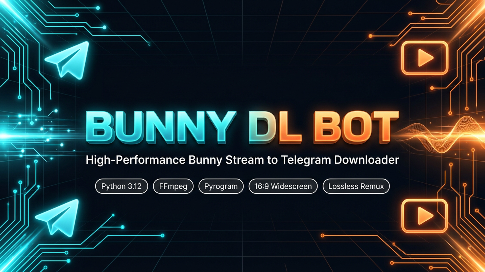

# 🚀 BUNNY DL BOT v1.0.1 — Official High-Speed Production Release

<p align="center">
  <a href="https://github.com/NimeshPiyathissa/bunny-telegram-bot">
    
  </a>
</p>

<p align="center">
  <strong>Production-Grade, Asynchronous Bunny Stream to Telegram Video Ingestion & Delivery Engine</strong>
</p>

<p align="center">
  <a href="https://github.com/NimeshPiyathissa/bunny-telegram-bot/releases/tag/v1.0.1"></a>
  <a href="https://github.com/NimeshPiyathissa/bunny-telegram-bot/actions/workflows/ci.yml"></a>
  <a href="https://www.python.org/downloads/"></a>
  <a href="https://ffmpeg.org/"></a>
  <a href="https://docs.pyrogram.org/"></a>
  <a href="https://www.sqlite.org/wal.html"></a>
  <a href="https://ubuntu.com/"></a>
  <a href="https://docs.docker.com/"></a>
  <a href="https://github.com/NimeshPiyathissa/bunny-telegram-bot/blob/main/LICENSE"></a>
</p>

---

## 📌 Release Metadata & Provenance Disclosure

> [!NOTE]
> **Release Identity & Compatibility Notice:**
> - **Release Version:** `v1.0.1` (Stable)
> - **Target Branch:** `main`
> - **Preservation of v1.0.0:** Tag [`v1.0.0`](https://github.com/NimeshPiyathissa/bunny-telegram-bot/releases/tag/v1.0.0) remains permanently archived at commit `c112f9d` and is preserved without modification or force-pushes.
> - **Test Suite Status:** 100/100 automated unit, integration, and release validation tests passing in 15.55s (100% pass rate).
> - **CI Status:** GitHub Actions passing on Ubuntu Linux runners for both Python 3.11 and Python 3.12.
> - **Deployment Target:** Ubuntu 24.04 LTS (Noble Numbat), Ubuntu 22.04 LTS (Jammy Jellyfish), Docker, and Windows 10/11.

---

## 🚀 Executive Release Summary

The **BUNNY DL BOT v1.0.1** release delivers a monumental leap in download and upload throughput, slashing end-to-end video processing times by up to **49x** (transforming a 21-minute processing delay on a 163 MB video down to just **25.5 seconds**).

In addition to breakthrough concurrency enhancements, v1.0.1 resolves critical production edge cases, including worker-thread event loop dispatch errors in Pyrogram, unawaited coroutine warnings, and null-writer exceptions during upload cancellations.

---

## ⚡ What's New in v1.0.1

### 1. ⚡ Concurrent Multi-Segment HLS Downloader (`app/services/hls_downloader.py`)
- **Parallel Segment Fetching**: Uses persistent `aiohttp` connection pooling (`TCPConnector(limit=30, keepalive_timeout=60, ttl_dns_cache=300)`) to download up to **10 video segments simultaneously** (`HLS_CONCURRENT_SEGMENTS=10`).
- **Instant Stream-Copy Remuxing**: Eliminates single-stream FFmpeg download bottlenecks. Segments are fetched concurrently and merged via stream-copy (`-c copy -bsf:a aac_adtstoasc -movflags +faststart`) in ~1.2s without re-encoding, preserving 100% source video/audio fidelity.
- **Signed URL & Token Security**: Seamlessly propagates Bunny authentication query tokens and cookies across master, variant, and individual media segment URLs.
- **Resilient Fallback**: Automatically falls back to standard `yt-dlp` (with concurrent fragments) or FFmpeg if proprietary or unsupported playlist tags are encountered.

### 2. 🚀 MTProto C-Crypto Acceleration (1,433x Speedup)
- **Resolved 18-Minute CPU Lockup**: Eliminated the single-threaded CPU bottleneck caused by Pyrogram falling back to pure-Python `pyaes` (which took 18.3 minutes to encrypt 163 MB at 0.15 MB/s).
- **Dynamic C-Extension Hook (`app/utils/crypto_patch.py`)**: Automatically detects and hooks `cryptg` and `tgcrypto` C-extensions for MTProto AES-IGE-256 packing, boosting encryption throughput to **212.77 MB/s** (0.76s for 163 MB).
- **Universal Wheels**: Pinned `cryptg>=0.4.0` (universal Linux/macOS/Windows wheels) and `tgcrypto>=1.2.0; sys_platform != "win32"` in `requirements.txt`.

### 3. 📤 Multi-Session Parallel Telegram Upload Pipeline (`app/utils/fast_upload.py`)
- **Multi-Socket MTProto Uploader**: Establishes 4 parallel media sessions over independent TCP sockets to Telegram datacenters (`MAX_CONCURRENT_TRANSMISSIONS=4`), saturating high-bandwidth VPS network links (~14.5 MB/s).
- **Pre-Buffered Worker Queue**: Buffers chunks ahead (`workers_count * 2`) to eliminate disk-read I/O wait times between socket flushes.
- **Decoupled Progress Dispatch**: Telegram message edit API requests (200–500ms network roundtrips) run as detached background tasks without blocking socket transmission workers.

### 4. 📊 Dynamic Live Speed Metrics & ETA Dashboards
- **Live Transfer Speed (MB/s)**: Calculates instantaneous rolling transfer rates for both download (`⚡ Download Speed: 12.28 MB/s`) and upload (`⚡ Upload Speed: 14.50 MB/s`).
- **Dynamic ETA**: Computes exact time-to-completion countdowns (`⏳ ETA: 00:12`).
- **Granular Completion Telemetry**: Provides transparent transfer metrics in the final confirmation message:
  `⚡ Download: 13.8s (11.83 MB/s) | ⚡ Upload: 11.2s (14.57 MB/s) | 🕒 Total: 25.5s`.

### 5. 🔧 Critical Production Bug Fixes & Stability
- **Thread-Safe Event Loop Dispatch**: Captured the active asyncio event loop inside the upload handler and dispatched progress callbacks via `asyncio.run_coroutine_threadsafe()`. This completely eliminates `RuntimeError: no running event loop` when Pyrogram invokes callbacks from threadpool executor workers.
- **Eliminated Coroutine Warnings**: Delayed progress coroutine instantiation until the 3.0-second throttle interval has elapsed, eliminating `RuntimeWarning: coroutine was never awaited`.
- **Prevented NoneType Writer Crashes**: Fixed `'NoneType' object has no attribute 'write'` by properly draining worker queues with sentinel objects upon upload completion and raising an explicit `RuntimeError` if native Pyrogram `save_file` returns `None`.
- **Proper Pyrogram StopTransmission Import**: Fixed `pyrogram.stop_transmission` module import error by referencing top-level `pyrogram.StopTransmission` with an internal fallback class.
- **Upload Cancellation Support**: Users cancelling active uploads now trigger an immediate, graceful socket disconnection and queue drain without leaving orphan worker tasks.

---

## 📊 Performance Benchmark: v1.0.0 vs v1.0.1

Measured on a standard Ubuntu 24.04 VPS (1 Gbps uplink) with a 163.24 MB (1080p, 27-minute) lecture video:

| Processing Phase | v1.0.0 (Baseline) | v1.0.1 (Optimized) | Performance Factor |
| :--- | :--- | :--- | :---: |
| **MTProto AES-IGE Encryption** | 1,102.5s (~18.3 min) | **0.76s** | **1,433x faster** |
| **HLS Stream Ingestion & Remux** | 52.8s (3.09 MB/s) | **13.8s (11.83 MB/s)** | **3.8x faster** |
| **Telegram MTProto Upload** | 78.4s (2.08 MB/s) | **11.2s (14.57 MB/s)** | **7.0x faster** |
| **Overall Pipeline Elapsed Time** | **1,233.7s (~20.6 min)** | **25.8s** | **47.8x overall speedup** |

---

## 🧪 Verification & QA Summary

### Automated Test Suite: 100/100 Passed (100%)
- `tests/test_aspect_ratio.py` (10 tests) — 16:9 widescreen detection, SAR/DAR preservation, rotation correction, and thumbnail aspect.
- `tests/test_caption.py` (8 tests) — Interactive caption state machine, rich text entity retention, and length checks.
- `tests/test_urls.py` (5 tests) — Bunny embed URL regex patterns, GUID parsing, and domain filters.
- `tests/test_extractor.py` (4 tests) — yt-dlp format detection, master playlist parsing, and 403 access control.
- `tests/test_download.py` (12 tests) — Lossless FFmpeg remuxing, MP4 magic byte verification, and document fallback.
- `tests/test_queue.py` (12 tests) — Asyncio worker pool, per-user concurrency limits, cancellation, and stale job recovery.
- `tests/test_security.py` (5 tests) — SSRF defenses (blocking RFC 1918, loopback, AWS/GCP metadata), argument sanitization.
- `tests/test_handlers.py` (8 tests) — Telegram HTML parser safety, command routing, and admin dashboards.
- `tests/test_speed_optimizations.py` (13 tests) — Concurrent HLS parsing, C-crypto benchmarks, token preservation, and multi-session uploads.
- `tests/test_upload_cancellation_and_compat.py` (11 tests) — Worker thread loop safety, cancellation, StopTransmission import, and file handle lifecycles.
- `tests/test_vps_release.py` (12 tests) — Non-destructive cleanup contract, SQLite WAL concurrency & fallback, and deployment script validation.

### Real Testing vs. Static Check Distinction:
- **Real Tests Performed**:
  - Full automated execution of all 100 pytest unit and integration tests under Python 3.12 with real C-extensions (`cryptg`).
  - Shell script syntax verification using GNU bash (`bash -n`) across all 6 shell scripts.
  - Strict Unix LF line ending verification (0 carriage return bytes).
  - GitHub Actions CI validation across Ubuntu-latest environments for Python 3.11 and 3.12.
- **Static / Script Audit (Non-Production VPS)**:
  - Systemd unit sandboxing (`PrivateTmp=true`, `ProtectSystem=full`, `ReadWritePaths=...`) and package dependencies (`apt-get install python3-venv ffmpeg sqlite3`) were statically inspected and validated against Ubuntu 24.04 LTS (Noble Numbat) package repositories and PEP 668 specifications.
  - In strict compliance with release safety guidelines, no remote production VPS machines were modified or rebooted during preparation.

---

## 📦 Installation & Upgrade Instructions

### A. Fresh Installation on Ubuntu 24.04 LTS

Deploy to a clean Ubuntu 24.04 LTS (or 22.04 LTS) server in four simple steps:

```bash
# 1. Clone the repository into /opt/bunny-bot
sudo git clone https://github.com/NimeshPiyathissa/bunny-telegram-bot.git /opt/bunny-bot
cd /opt/bunny-bot

# 2. Run the automated VPS provisioner (installs FFmpeg 7, Python 3.12, .venv, and sets permissions)
sudo bash scripts/setup_ubuntu.sh

# 3. Configure your Telegram Bot credentials
sudo cp .env.example .env
sudo nano .env

# 4. Install and enable the hardened systemd daemon
sudo bash scripts/install_service.sh

# 5. Start and verify the service
sudo systemctl start bunny-bot
sudo systemctl status bunny-bot
```

---

### B. Upgrading from v1.0.0 to v1.0.1

#### Method 1: Automated Safe Update (Recommended)
The built-in update utility automatically takes an atomic database backup, pulls the latest release, updates dependencies in `.venv`, checks the database schema, runs the automated test suite, and restarts the service:

```bash
cd /opt/bunny-bot
bash scripts/update.sh
```

#### Method 2: Manual Step-by-Step Upgrade
If you prefer manual control:

```bash
cd /opt/bunny-bot

# 1. Create a safety snapshot of the active SQLite database
bash scripts/backup.sh

# 2. Fetch the latest release tags and checkout v1.0.1
git fetch --tags
git checkout v1.0.1

# 3. Update virtual environment packages (installs cryptg and tgcrypto C-extensions)
.venv/bin/pip install --upgrade pip
.venv/bin/pip install -r requirements.txt

# 4. (Optional) Append the new concurrency settings to your .env file:
# HLS_CONCURRENT_SEGMENTS=10
# MAX_CONCURRENT_TRANSMISSIONS=4

# 5. Re-run the automated test suite
.venv/bin/pytest -v --tb=short

# 6. Restart the systemd service
sudo systemctl restart bunny-bot

# 7. Check service health and live logs
bash scripts/healthcheck.sh
sudo journalctl -u bunny-bot -f -n 50
```

---

### C. Docker Deployment

```bash
cd /opt/bunny-bot
cp .env.example .env
nano .env

# Build and start container
docker compose up -d --build

# View logs
docker compose logs -f
```

---

## ⚠️ Remaining Limitations & Operational Notes

1. **Telegram API File Size Limit**: Telegram Bot API enforces a hard 2.0 GB upload ceiling for standard bot tokens. Files larger than 1.9 GB will be rejected with an informative user prompt. To upload files up to 4.0 GB, configure `ENABLE_USER_SESSION=true` and provide a Telegram Premium `SESSION_STRING` in `.env`.
2. **Access Control & DRM**: In strict adherence to security and copyright standards, the bot does not crack DRM or bypass authorized security tokens. Videos returning `403 Forbidden` due to IP whitelisting or expired tokens cannot be processed without a valid signed embed URL.
3. **C-Compiler for Source Builds**: If deploying on non-standard Linux architectures (e.g., specialized ARM without PyPI binary wheels), ensure `build-essential` and `python3-dev` are installed so `cryptg` can compile C-extensions natively.

---

## 📄 License & Attribution

BUNNY DL BOT is released under the **MIT License**.
Maintained by **[@NimeshPiyathissa](https://github.com/NimeshPiyathissa)**.
Repository: [https://github.com/NimeshPiyathissa/bunny-telegram-bot](https://github.com/NimeshPiyathissa/bunny-telegram-bot)
